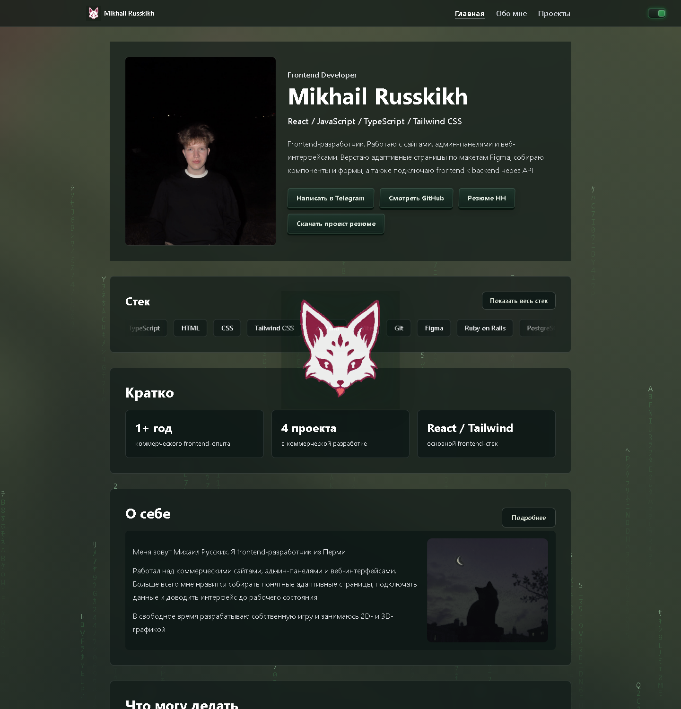
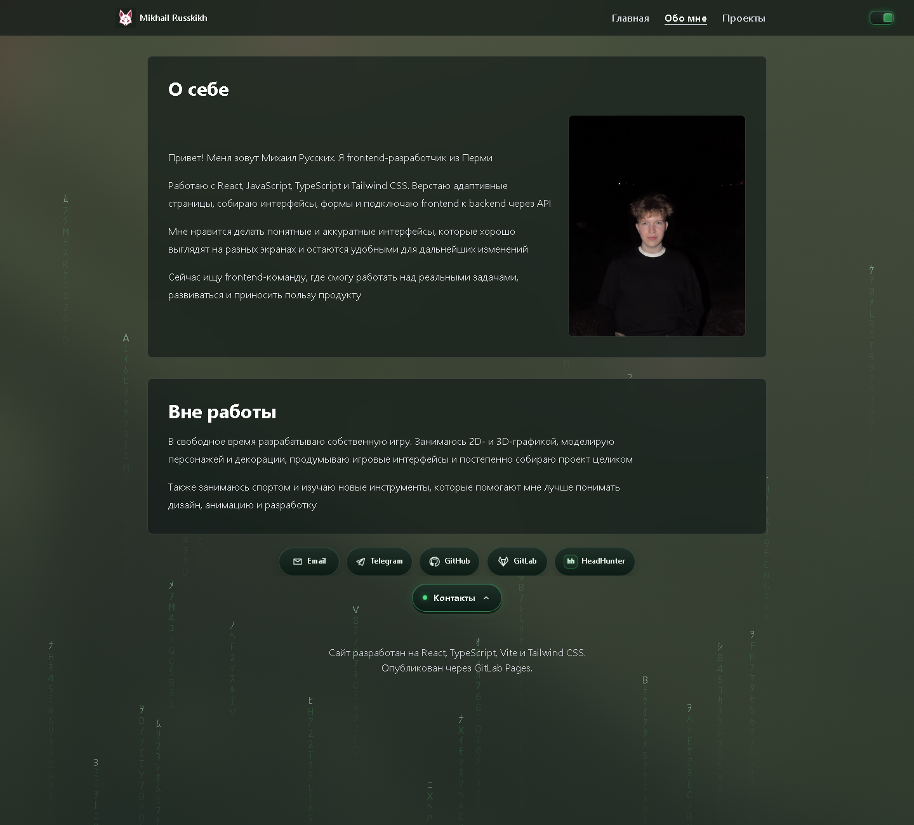
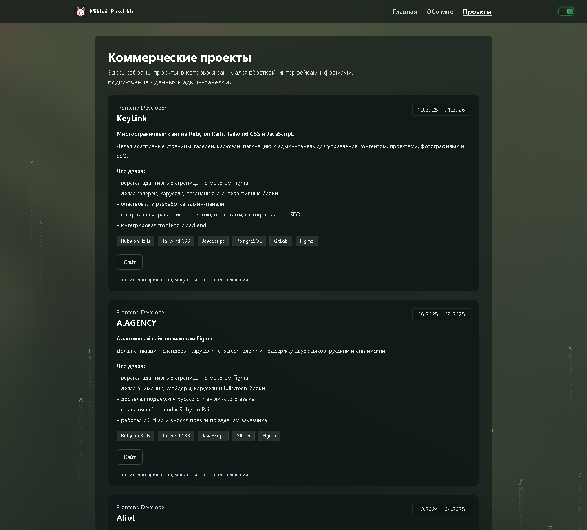

# Михаил Русских — Frontend Developer

[](https://deazi-c87e25.gitlab.io/)
[](https://deazi-c87e25.gitlab.io/)

Личное портфолио: проекты, опыт, технологии и контакты.

### [Открыть портфолио →](https://deazi-c87e25.gitlab.io/)

## Новый проект

### Гротеск | Тестовое задание

Выполнил тестовое для студии «Гротеск»: по макету Figma сделал корзину, оформление заказа и страницу успеха

- Адаптировал страницы под 414, 768, 1366 и 1920 px
- Подключил товары из API задания, изменение количества с учётом остатка и удаление товаров
- Добавил расчёт суммы и скидки, промокод GROWTASK2026 и удаление выбранных товаров
- Сделал сохранение корзины, маску телефона и проверку полей формы
- Собрал данные заказа в массив и вывел в консоль, как требовалось в задании

**HTML · CSS · JavaScript · Vite**

[Сайт](https://grotesk-test.vercel.app/cart) · [Задание в Figma](https://www.figma.com/design/H17rbtGzwDMRoQQyukYjPT/?node-id=9001-185164) · [Код](https://gitlab.com/Deazi/Grotesk_test) · [Скриншоты](https://deazi-c87e25.gitlab.io/experience.html#grotesk)

## Скриншоты

### Главная

<p>
  
</p>

### Обо мне

<p>
  
</p>

### Опыт

<p>
  
</p>

## Стек

`TypeScript` · `Vite` · `Tailwind CSS` · `HTML` · `CSS`

## В портфолио

- проекты с live demo и исходным кодом;
- опыт и используемые технологии;
- контакты и резюме.

## Локальный запуск

```bash
npm install
npm run dev
```

---

**Live:** https://deazi-c87e25.gitlab.io/